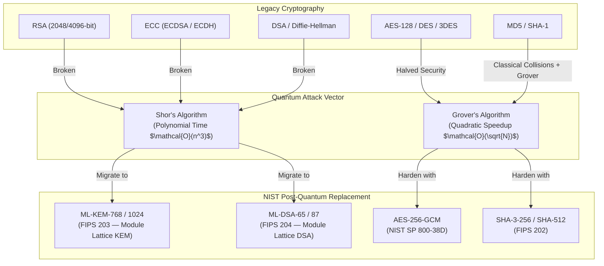
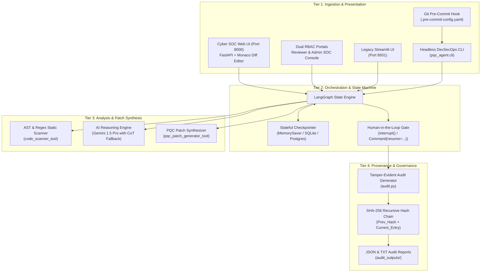
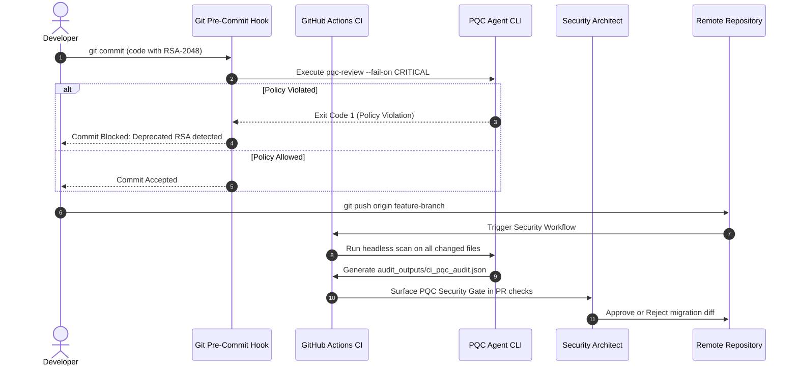

# 🛡️ Design and Development of a Post-Quantum Cryptography-Based Secure Code Review Tool
## Production DevSecOps & AI Systems Architectural Blueprint

> **System Classification**: Agentic Cyber Defence System (Track 1)  
> **Target Standard Alignment**: NIST FIPS 203 (ML-KEM), NIST FIPS 204 (ML-DSA), NIST FIPS 202 (SHA-3), NSA CNSA 2.0  
> **Security Baseline**: Non-repudiation, Zero Trust Code Modification, Tamper-Evident SHA-256 Chained Auditing

---

## 1. Executive Architectural Summary

The **Post-Quantum Cryptography (PQC) Secure-Code Reviewer** is an enterprise-grade agentic DevSecOps system designed to address the systemic threat of **"Harvest Now, Decrypt Later" (HNDL)** attacks. 

Traditional static application security testing (SAST) tools lack mathematical contextual awareness: they cannot differentiate between Shor-vulnerable asymmetric schemes and Grover-affected symmetric ciphers, cannot generate validated quantum-resistant replacement code, and offer no cryptographic provenance for automated changes. 

This platform integrates:
1. **Deterministic Multi-Language Static Analysis**: AST (Python) and regex syntax trees (Java).
2. **Autonomous Chain-of-Thought (CoT) Reasoning**: Powered by an LLM with explicit uncertainty quantification.
3. **Hard Human-in-the-Loop (HITL) Gate**: Enforced via LangGraph's native stateful `interrupt()` and `Command(resume=...)` primitives.
4. **Cryptographic Tamper-Evident Auditing**: A blockchain-style SHA-256 hash chain providing non-repudiation across all decisions.
5. **Multi-Modal Operation Interfaces**: A high-performance **Cyber SOC Web Dashboard** powered by FastAPI (Port 8000) with Monaco side-by-side patch diffing and dual-portal RBAC (Reviewer Portal & Admin SOC Console), a headless CLI engine for automated CI/CD pipeline gates, and an optional legacy Streamlit interface (Port 8501).

---

## 2. Threat Modeling & Cryptographic Risk Matrix

### 2.1 Quantum Adversary Threat Model
* **Harvest Now, Decrypt Later (HNDL)**: Adversaries passively record encrypted network traffic and code repositories today. Once a Cryptographically Relevant Quantum Computer (CRQC) becomes viable, all data protected by classical public key cryptography will be retroactively decrypted.
* **Shor's Algorithm Impact**: Solves integer factorization and discrete logarithms in polynomial time $\mathcal{O}((\log N)^3)$. It completely collapses RSA, DSA, ECDSA, DH, and ECDH.
* **Grover's Algorithm Impact**: Provides a quadratic speedup for unstructured database search $\mathcal{O}(\sqrt{N})$. Symmetric encryption (AES) and hashing (SHA-256) effectively lose half their key length. AES-128 drops to 64-bit security (insufficient); AES-256 retains 128-bit quantum security (fully secure).



---

## 3. Four-Tier Production System Architecture



---

## 4. LangGraph Five-Node State Pipeline

The core execution engine is a strictly bounded Directed Acyclic Graph (DAG) with five states:

```
  ┌──────────┐      ┌──────────┐      ┌───────────────┐
  │  INGEST  │ ───▶ │   SCAN   │ ───▶ │  INVESTIGATE  │
  └──────────┘      └──────────┘      └───────┬───────┘
                                              │
                                              ▼
                                    ┌───────────────────┐
                                    │  HUMAN APPROVAL   │ ◀── [interrupt()]
                                    │    (HITL Gate)    │
                                    └─────────┬─────────┘
                                              │ [Command(resume=...)]
                                              ▼
                                    ┌───────────────────┐
                                    │     FINALISE      │ ───▶ [END]
                                    └───────────────────┘
```

1. **INGEST**: Validates file integrity, detects programming language (`.py`, `.java`), initializes state payload, and computes the genesis audit hash block.
2. **SCAN**: Pure deterministic static code scan using Abstract Syntax Tree inspection for Python (`ast.parse`) and regex pattern sets for Java. Assigns line numbers, code snippets, and confidence metrics ($0.95$ for explicit imports, $0.85$ for call sites, $0.75$ for regex).
3. **INVESTIVATE**: Analyzes flagged primitives using Chain of Thought. Generates NIST-standardized replacement patches. Evaluates whether findings are in test fixtures or security-critical paths. If the LLM provider is unavailable, falls back gracefully to a deterministic rule engine without throwing uncaught exceptions.
4. **HUMAN APPROVAL (HITL Gate)**: Halts execution via LangGraph's `interrupt()` primitive. Surfaces the code diff, CoT explanation, and uncertainty notes to the reviewer. Resumes **only** when a signed decision (`approved` or `rejected`) is provided via `Command(resume=...)`.
5. **FINALISE**: Seals the proposed patches as "ready to apply" or "rejected", generates the final SHA-256 chain hash block, and writes immutable JSON/TXT audit reports.

---

## 5. DevSecOps CI/CD Integration & Shift-Left Gates



### DevSecOps CLI Exit Code Standards:
* `0`: **Clean** — No policy violations found. Code complies with PQC standard.
* `1`: **Policy Violation** — Deprecated cryptographic algorithm detected at or above configured severity threshold (`fail_on_severity: CRITICAL`). Blocks pipeline build.
* `2`: **Execution Error** — Malformed configuration, invalid target directory, or unparseable source file.

---

## 6. Cryptographic Tamper-Evident Hash Chaining

To guarantee compliance with SOC 2 Type II (Trust Services Criteria) and NIST SP 800-53 (AU-10 Non-repudiation), each audit record is cryptographically linked to its predecessor using SHA-256:

$$\text{ChainHash}_0 = \text{SHA256}(\text{"0"} \times 64)$$
$$\text{ChainHash}_i = \text{SHA256}(\text{CanonicalJSON}(\text{Entry}_i) \mathbin{\Vert} \text{ChainHash}_{i-1})$$

```python
def _compute_chain_hash(entries: list[dict]) -> str:
    prev_hash = "0" * 64  # Genesis
    for entry in entries:
        payload = json.dumps(entry, sort_keys=True) + prev_hash
        prev_hash = hashlib.sha256(payload.encode()).hexdigest()
    return prev_hash
```

If an adversary alters any historical finding, severity level, or human decision timestamp, the calculated chain hash completely diverges, proving tampering immediately during third-party audit verification.

---

## 7. Compliance & Regulatory Standards Mapping

| Standard | Control ID | Control Name | PQC Reviewer Implementation |
| :--- | :--- | :--- | :--- |
| **NIST SP 800-53 Rev. 5** | `SC-13` | Cryptographic Protection | Detects sub-128-bit quantum primitives and guides migration to FIPS 203/204. |
| **NIST SP 800-53 Rev. 5** | `AU-2` | Event Logging | Automatically logs scan start, findings, LLM reasoning, and decisions. |
| **NIST SP 800-53 Rev. 5** | `AU-10` | Non-Repudiation | SHA-256 chain hashing guarantees that human approval events cannot be altered or denied. |
| **SOC 2 Type II** | `CC6.1` | Logical Access Security | Enforces strict Human-in-the-Loop review before cryptographic changes are authorized. |
| **SOC 2 Type II** | `CC7.1` | Vulnerability Management | Continuous scanning of code repositories via pre-commit hooks and CI/CD pipelines. |
| **NSA CNSA 2.0** | Timeline | PQC Migration Mandate | Supports transition planning to ML-KEM and ML-DSA before the 2030–2033 national deadlines. |
